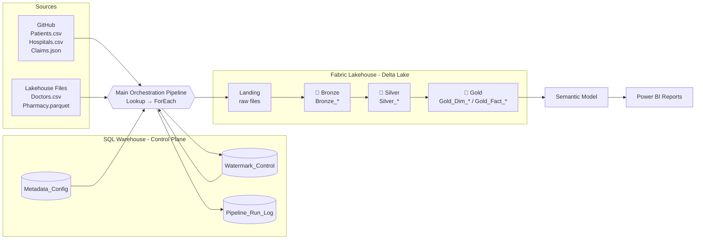
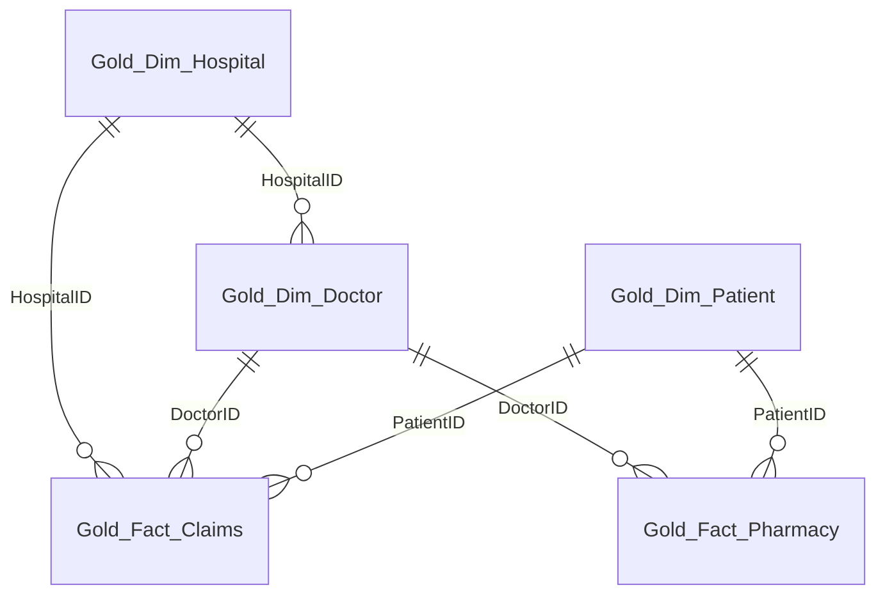

# 🏥 Stanford Healthcare Analytics: Metadata-Driven Medallion Lakehouse on Microsoft Fabric

An end-to-end, **metadata-driven data engineering project** built on **Microsoft Fabric**. It ingests healthcare data (patients, doctors, hospitals, claims, pharmacy) from multiple sources and formats through a **Medallion Architecture (Bronze → Silver → Gold)**. One reusable set of pipelines and notebooks handles every source, controlled entirely by configuration tables in a **Fabric SQL Warehouse**.


---

## 📌 Table of Contents

1. [Problem Statement](#-problem-statement)
2. [Use Case](#-use-case)
3. [Business Requirements](#-business-requirements)
4. [Solution Overview](#-solution-overview)
5. [Medallion Architecture](#-medallion-architecture)
6. [Tech Stack](#-tech-stack)
7. [Data Sources](#-data-sources)
8. [Metadata-Driven Design](#-metadata-driven-design)
9. [Pipelines](#-pipelines)
10. [Notebooks](#-notebooks)
11. [Incremental Load Strategy](#-incremental-load-strategy)
12. [Gold Layer Model](#-gold-layer-model)
13. [Monitoring & Audit](#-monitoring--audit)
14. [Project Structure](#-project-structure)
15. [How to Run](#-how-to-run)
16. [Key Learnings](#-key-learnings)
17. [Known Limitations & Future Enhancements](#-known-limitations--future-enhancements)
18. [Author](#-author)

---

## ❗ Problem Statement

Healthcare organizations collect data from many disconnected systems: patient registrations, doctor and hospital master data, insurance claims, and pharmacy transactions. These arrive in **different formats** (CSV, JSON, Excel, Parquet) and from **different locations** (GitHub, Lakehouse files).

Traditionally, each source needs its own copy activity, its own pipeline, and its own transformation logic. This leads to:

- **Repetitive development:** a new source means a new pipeline built from scratch.
- **Hard-coded values:** file names, paths, and load logic are buried inside pipelines.
- **Full reloads:** the same data is reloaded every run, wasting time and compute.
- **No traceability:** there is no record of what was loaded, when, or how many rows.
- **Inconsistent data quality:** duplicates, nulls, and mismatched data types reach reports.
- **Slow analytics:** analysts cannot get a trusted, unified view of claims, patients, doctors, and hospitals.

> **Core challenge:** load all sources at once without building a separate copy activity for each, and keep the process reusable, incremental, and auditable.

---

## 🎯 Use Case

A healthcare analytics team at a hospital network needs a **single, trusted analytical layer** so business users can answer questions such as:

- How many claims were submitted, approved, or rejected per hospital and insurance provider?
- What is the gap between claimed amount and approved amount?
- Which doctors and specialties generate the most claims?
- Which hospitals (by type, city, state, rating, bed count) perform best?
- How do pharmacy sales relate to patients and prescribing doctors?
- What is the patient demographic distribution by city, state, and gender?

The pipeline refreshes this data **incrementally** on every run, so reports reflect the latest records without reprocessing history.

---

## 📋 Business Requirements

| # | Requirement | How it is met |
|---|-------------|---------------|
| BR-1 | Ingest data from multiple sources and formats without separate copy activities | One metadata-driven pipeline with a `ForEach` loop over `Metadata_Config` |
| BR-2 | Support CSV, JSON, Excel, and Parquet | `FileFormat` column drives the read logic in the Bronze notebook |
| BR-3 | Support GitHub and Lakehouse as sources | `SourceType` and `SourcePath` columns in the metadata table |
| BR-4 | Load only new or changed data | Watermark on `ModifiedDate` stored in `Watermark_Control` |
| BR-5 | Add or disable a source without code changes | `IsActive` flag and config rows |
| BR-6 | Clean, deduplicated, validated data | Silver layer: schema validation, duplicate removal, null handling |
| BR-7 | Analytics-ready dimensional model | Gold layer: dimension and fact tables, upserted by business key |
| BR-8 | Full auditability of every run | `Pipeline_Run_Log` records run ID, times, row count, and status |
| BR-9 | Self-service reporting | Power BI semantic model on top of the Gold tables |
| BR-10 | Schema changes should not break loads | Delta `mergeSchema` and `autoMerge` enabled |

---

## 💡 Solution Overview

1. **Control plane (SQL Warehouse):** three tables (`Metadata_Config`, `Watermark_Control`, `Pipeline_Run_Log`) hold *what* to load, *from where*, *how*, and *since when*.
2. **Orchestration (Data Pipelines):** a main pipeline reads the metadata, loops over every active source, and calls the ingestion, Bronze, Silver, and Gold pipelines in order.
3. **Transformation (PySpark notebooks):** three **parameterized, reusable** notebooks handle every source. The pipeline passes `SourceName`, `FileName`, `FileFormat`, `LoadType`, `IncrementalColumn`, `BusinessKey`, and `WatermarkDate`.
4. **Storage (Lakehouse + Delta Lake):** Bronze, Silver, and Gold tables are stored as Delta tables.
5. **Serving (Semantic Model + Power BI):** reports consume the Gold layer.

Adding a new source is a single `INSERT` into `Metadata_Config`. No new pipeline is needed.

---

## 🏅 Medallion Architecture

The project follows the **Medallion (multi-hop) Architecture**, where data improves in quality and structure as it moves through three layers.

### End-to-end flow



### Layer summary

| | 🥉 Bronze | 🥈 Silver | 🥇 Gold |
|---|-----------|-----------|---------|
| **Purpose** | Raw, as-received copy of source data | Cleansed, validated, deduplicated data | Business-ready dimensional model |
| **Input** | `Files/Landing/<Source>/<File>` | `Bronze_<Source>` | `Silver_<Source>` |
| **Output tables** | `Bronze_Patients`, `Bronze_Doctors`, `Bronze_Hospitals`, `Bronze_Claims`, `Bronze_Pharmacy` | `Silver_Patients`, `Silver_Doctors`, `Silver_Hospitals`, `Silver_Claims`, `Silver_Pharmacy` | `Gold_Dim_Patient`, `Gold_Dim_Doctor`, `Gold_Dim_Hospital`, `Gold_Fact_Claims`, `Gold_Fact_Pharmacy` |
| **Notebook** | `NB_Bronze_Load` | `NB_Silver_Load` | `NB_Gold_Load` |
| **Pipeline** | `Pl_bronze` | `Pl_silver_load` | `Pl_gold` |
| **Write mode** | Overwrite (Full) / Append (Incremental) | Create on first load, then `MERGE` | Create on first load, then `MERGE` |
| **Consumers** | Silver layer, reprocessing | Gold layer, data engineers | Semantic model, Power BI, analysts |

### 🥉 Bronze layer: raw ingestion

- Stores data **exactly as it arrives**, with no business transformation.
- Reads the format given by `FileFormat` (CSV with header, JSON, or Parquet).
- **Full load:** overwrites `Bronze_<SourceName>`.
- **Incremental load:** keeps rows where `IncrementalColumn > WatermarkDate` and **appends** them.
- Returns the processed record count to the pipeline for auditing.
- Acts as the replayable source of truth, so Silver and Gold can be rebuilt without going back to the source.

### 🥈 Silver layer: cleansed and conformed

- Validates that the incremental column exists (schema validation).
- Enables Delta **schema evolution** (`autoMerge`) so new columns do not break loads.
- Filters to new records (incremental) and exits early with `NO_DATA` when nothing changed.
- Removes duplicate rows and null rows.
- **First run:** creates the Silver Delta table.
- **Later runs:** **upserts** (`MERGE`) on the `BusinessKey`: matched rows are updated, new rows are inserted.

### 🥇 Gold layer: business-ready model

- Maps each source to a **dimension** or **fact** table.
- Validates that both `BusinessKey` and `IncrementalColumn` exist.
- Drops rows with a null business key and deduplicates by key.
- **Standardizes data types:** IDs (`PatientID`, `DoctorID`, `HospitalID`, `ClaimID`) are cast to `string` so joins work across tables.
- Converts epoch-millisecond date columns to proper timestamps.
- Creates the Gold table on the first load, then **`MERGE`s** (update matched, insert new).
- Feeds the **semantic model** and Power BI reports.

### Why Medallion?

- **Separation of concerns:** ingestion, cleaning, and modelling are independent and easy to debug.
- **Reprocessing:** a logic error in Silver or Gold is fixed by replaying from Bronze.
- **Data quality improves at every hop**, so analysts only touch trusted data.
- **Auditability:** raw data is always retained.

> 📷 *Add your own architecture diagram here:* ``

---

## 🧰 Tech Stack

| Layer | Technology |
|-------|-----------|
| Platform | Microsoft Fabric |
| Orchestration | Fabric Data Pipelines (Lookup, ForEach, Notebook, Script, Copy activities) |
| Compute | Apache Spark / PySpark notebooks |
| Storage | Fabric Lakehouse, Delta Lake |
| Control tables | Fabric SQL Warehouse (T-SQL) |
| Source hosting | GitHub (raw files), Lakehouse Files |
| Serving | Semantic Model, Power BI |
| Monitoring | Fabric Monitor hub, custom `Pipeline_Run_Log` table |

---

## 📂 Data Sources

| Source | Type | Format | Business Key | Description |
|--------|------|--------|--------------|-------------|
| Patients | GitHub | CSV (DelimitedText) | `PatientID` | Patient demographics and insurance |
| Hospitals | GitHub | CSV (DelimitedText) | `HospitalID` | Hospital master data |
| Claims | GitHub | JSON | `ClaimID` | Insurance claims with amounts and status |
| Doctors | Lakehouse | CSV (DelimitedText) | `DoctorID` | Doctor master data and specialization |
| Pharmacy | Lakehouse | Parquet | `TransactionID` | Pharmacy transactions |

---

## 🗄 Metadata-Driven Design

All behaviour is controlled from three SQL Warehouse tables.

### `Metadata_Config`: what to load and how

```sql
CREATE TABLE Metadata_Config
(
    SourceName        VARCHAR(100),
    SourceType        VARCHAR(50),    -- GitHub / Lakehouse
    FileName          VARCHAR(200),
    LoadType          VARCHAR(50),    -- Full / Incremental
    IncrementalColumn VARCHAR(100),   -- e.g. ModifiedDate
    TargetFolder      VARCHAR(200),   -- e.g. Landing/Patients
    IsActive          CHAR(1),        -- Y / N
    SourcePath        VARCHAR(1000),
    FileFormat        VARCHAR(50),    -- DelimitedText / JSON / Parquet / Excel
    BusinessKey       VARCHAR(100)    -- used for MERGE
);
```

### `Watermark_Control`: incremental load tracking

```sql
CREATE TABLE Watermark_Control
(
    TableName    VARCHAR(100),
    LastLoadDate DATETIME2(6)
);

-- Initial state: everything loads on the first run
INSERT INTO Watermark_Control VALUES
('Patients','1900-01-01'), ('Hospitals','1900-01-01'),
('Pharmacy','1900-01-01'), ('Doctors','1900-01-01'),
('Claims','1900-01-01');
```

### `Pipeline_Run_Log`: audit trail

```sql
CREATE TABLE Pipeline_Run_Log
(
    RunID            VARCHAR(100),
    SourceName       VARCHAR(100),
    StartTime        DATETIME2(6),
    EndTime          DATETIME2(6),
    RecordsProcessed INT,
    Status           VARCHAR(50)
);
```

### Final configuration

| SourceName | SourceType | FileName | FileFormat | BusinessKey |
|-----------|------------|----------|------------|-------------|
| Patients | GitHub | Patients.csv | DelimitedText | PatientID |
| Hospitals | GitHub | Hospitals.csv | DelimitedText | HospitalID |
| Claims | GitHub | Claims.json | JSON | ClaimID |
| Doctors | Lakehouse | Doctors.csv | DelimitedText | DoctorID |
| Pharmacy | Lakehouse | Pharmacy.parquet | Parquet | TransactionID |

---

## 🔄 Pipelines

| Pipeline | Purpose |
|----------|---------|
| `Pl_Ingestion` | Copies source files (GitHub / Lakehouse) into `Files/Landing/<Source>/` |
| `Pl_bronze` | Looks up the watermark (`Lk_watermark`) and runs the Bronze notebook |
| `Pl_silver_load` | Looks up the watermark and runs the Silver notebook |
| `Pl_gold` | Looks up the watermark and runs the Gold notebook |
| `Main_pipeline_orchestration` | Reads active rows from `Metadata_Config`, loops over each source with `ForEach`, runs ingestion → Bronze → Silver → Gold, updates the watermark, and writes to `Pipeline_Run_Log` |

**Flow per source:**

```
Lookup Metadata_Config (IsActive = 'Y')
   └─ ForEach source
        ├─ Lookup watermark (Watermark_Control)
        ├─ Pl_Ingestion   → Landing
        ├─ Pl_bronze      → Bronze_<Source>
        ├─ Pl_silver_load → Silver_<Source>
        ├─ Pl_gold        → Gold_<Dim/Fact>
        ├─ Update Watermark_Control
        └─ Insert Pipeline_Run_Log (rows, status, times)
```

> 📷 *Add pipeline screenshots:* `images/pipeline_main.png`, `images/monitor.png`

---

## 📓 Notebooks

All three notebooks are **generic** and receive behaviour through pipeline parameters.

**Parameters:** `SourceName`, `FileName`, `FileFormat`, `LoadType`, `IncrementalColumn`, `BusinessKey`, `WatermarkDate`

| Notebook | Layer | Key steps |
|----------|-------|-----------|
| `NB_Bronze_Load` | 🥉 Bronze | Build landing path → read by format → full overwrite or incremental append → return count |
| `NB_Silver_Load` | 🥈 Silver | Read Bronze → validate schema → enable schema evolution → filter → `NO_DATA` check → dedupe/clean → create or `MERGE` |
| `NB_Gold_Load` | 🥇 Gold | Map Silver → Gold table → validate keys → filter → clean keys → cast types → convert epoch dates → create or `MERGE` |

---

## ⏱ Incremental Load Strategy

**What happens when the same file is updated the next day with new or modified rows:**

1. The ingestion step copies the file into Landing.
2. Bronze keeps only rows where `ModifiedDate > WatermarkDate` and appends them.
3. Silver and Gold filter by the watermark again and `MERGE` on the business key, so only new or changed rows are inserted or updated.
4. After a successful run, `Watermark_Control` is updated.

**Honest scope note:** in this project the *write path* is incremental, but the *source read* still copies the full file into Landing. That is fine for the sample data volume. At millions of rows, push the filter to the source:

| Source type | Production approach |
|-------------|--------------------|
| Database / API | `SELECT ... WHERE ModifiedDate > @watermark` so only changed rows leave the source |
| Files | Source drops a new file per day/hour into dated folders; ingest only files newer than the last run |
| High-volume or critical systems | CDC (change data capture) or change feed to capture inserts, updates, and deletes |

The metadata and watermark design is ready for this. Only the ingestion step would change; Bronze, Silver, Gold, and the control tables stay the same.

---

## ⭐ Gold Layer Model

| Silver Table | Gold Table | Type |
|--------------|-----------|------|
| `Silver_Patients` | `Gold_Dim_Patient` | Dimension |
| `Silver_Doctors` | `Gold_Dim_Doctor` | Dimension |
| `Silver_Hospitals` | `Gold_Dim_Hospital` | Dimension |
| `Silver_Claims` | `Gold_Fact_Claims` | Fact |
| `Silver_Pharmacy` | `Gold_Fact_Pharmacy` | Fact |

**Star schema relationships:**



---

## 📊 Monitoring & Audit

- **Fabric Monitor hub:** run history, durations, and failures for every pipeline.
- **`Pipeline_Run_Log`:** run ID, source name, start/end time, records processed, and status per source.
- **`Watermark_Control`:** last successful load date per source.

```sql
SELECT * FROM Pipeline_Run_Log ORDER BY StartTime DESC;
SELECT * FROM Watermark_Control;
```

---

## 📁 Project Structure

```
healthcare-files/
├── Patients.csv                      # source data (GitHub source)
├── Hospitals.csv                     # source data (GitHub source)
├── Claims.json                       # source data (GitHub source)
├── Doctors.csv                       # source data (Lakehouse source)
├── Pharmacy.parquet                  # source data (Lakehouse source)
├── NB_Bronze_Load.ipynb              # Bronze notebook
├── NB_Silver_Load.ipynb              # Silver notebook
├── NB_Gold_Load.ipynb                # Gold notebook
├── PL_Healthcare_Ingestion.zip       # ingestion pipeline
├── PL_Bronze_Load.zip                # Bronze pipeline
├── PL_Silver_Load.zip                # Silver pipeline
├── PL_Gold_Load.zip                  # Gold pipeline
├── Main pipeline_orchestration.zip   # main orchestration pipeline
├── Healthcare Analytics report.pbix  # Power BI report
├── semantic model_schema.png         # semantic model screenshot
├── relationships for semantic model.png
├── fabric project stanford.docx      # project notes & control-table SQL
└── README.md
```

### Semantic model


---

## 🚀 How to Run

1. **Create a Fabric workspace** with a **Lakehouse** (e.g. `Destination_lakehouse`) and a **SQL Warehouse**.
2. **Run the control-table SQL** in the Warehouse to create `Metadata_Config`, `Watermark_Control`, and `Pipeline_Run_Log`, and insert the configuration rows.
3. **Upload source files** to the Lakehouse `Files/` area (Doctors, Pharmacy) and host the GitHub files (Patients, Hospitals, Claims) in a public repo.
4. **Import the three notebooks** and attach them to the Lakehouse.
5. **Create the pipelines** (`Pl_Ingestion`, `Pl_bronze`, `Pl_silver_load`, `Pl_gold`) and the **main orchestration pipeline**. In each notebook activity, pass the parameters listed above as base parameters.
6. **Run `Main_pipeline_orchestration`.** The first run does a full historical load (watermark `1900-01-01`). Later runs load only new or modified records.
7. **Build the semantic model** on the Gold tables and connect Power BI.

---

## 🎓 Key Learnings

- Designing a **metadata-driven framework** that removes repetitive pipeline development.
- Implementing **incremental loading** with watermarks and Delta `MERGE`.
- Applying the **Medallion Architecture** with clear responsibilities per layer.
- Handling **multiple file formats and sources** with one parameterized codebase.
- Building **audit logging** and **schema evolution** into a production-style pipeline.
- Handling data-type issues such as epoch-millisecond dates and numeric IDs.

---

## 🔮 Known Limitations & Future Enhancements

**Known limitations**

- Ingestion copies the full source file; the incremental filter is applied in Bronze (see [Incremental Load Strategy](#-incremental-load-strategy)).
- Incremental Bronze appends, so a modified record can appear twice. Silver and Gold should keep only the **latest row per business key** (`row_number()` over `ModifiedDate` descending) before the `MERGE`.
- `ModifiedDate` for Claims arrives as epoch milliseconds; convert it to a timestamp before comparing with the watermark.
- Update the watermark only after Gold succeeds.

**Future enhancements**

- Source-side incremental extraction (query filter, dated files, or CDC).
- SCD Type 2 history on dimensions.
- Data quality rules and a rejected-records table.
- Failure alerts (email / Teams) and retry logic.
- Surrogate keys and a date dimension in Gold.
- CI/CD with Fabric Git integration and deployment pipelines.

---

## 👤 Author

**Vishnu Dorigundla**
📧 vishnudorigundla453@gmail.com
🔗 [LinkedIn]([https://linkedin.com/in/your-profile](https://www.linkedin.com/in/vishnu-vardhan-reddy-dorigundla-353bb1255/)) | [GitHub](https://github.com/vishnudorigundla)

⭐ If you found this project useful, please star the repository!
